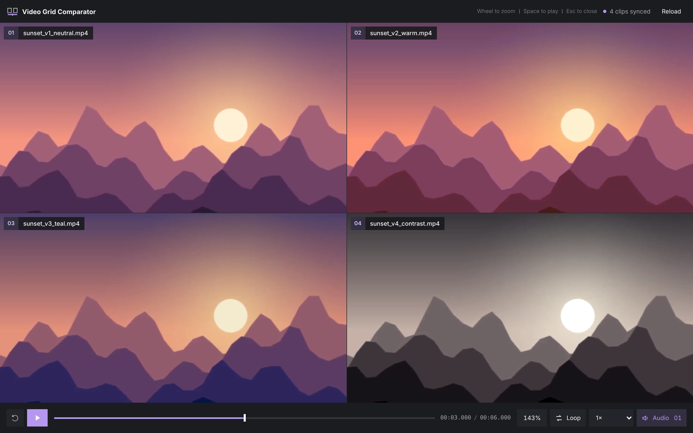

<p align="center">
  
</p>

# Video Grid Comparator

[](https://github.com/Opus721/eagle-video-grid-comparator/releases/latest)
[](LICENSE)
[](https://eagle.cool)

An [Eagle](https://eagle.cool) plugin that plays two to four selected videos side by side under one synchronized transport.



## Features

- Compare 2–4 Eagle videos in a responsive grid: two or three in a row, four as a 2×2 grid.
- One shared timeline, play/pause, speed, loop, and audio source for every clip.
- Synchronized wheel zoom and drag-to-pan, so the same detail is inspected in every clip at once.
- Smooth scrubbing on three and four clips: rapid timeline moves are coalesced into one exact seek on release.
- A **Compare** button in Eagle's inspector, plus the normal Plugin menu entry.
- Follows Eagle's light and dark themes.

The plugin only reads the selected items and their local files. It never modifies, copies, or uploads media and does not write inside an Eagle library.

## Install

- **Eagle Plugin Center:** search for *Video Grid Comparator* and press **Install**.
- **Manual:** download `Video Grid Comparator <version>.eagleplugin` from [Releases](https://github.com/Opus721/eagle-video-grid-comparator/releases) and open it with Eagle.

Requires Eagle 4 on Windows or macOS.

## Use

1. Select 2–4 videos in Eagle.
2. Press **Compare** in the inspector, or run **Video Grid Comparator** from the Plugin menu.
3. Review the clips with the shared controls. Press `Esc` to close.

MP4 with H.264 is the safest format. Other formats play when Eagle's built-in Chromium can decode their codec; a clip that cannot be decoded is marked in its tile while the others keep playing.

### Controls

| Input | Action |
| --- | --- |
| Click a video / `Space` | Play or pause |
| Drag the timeline | Scrub all clips together |
| `Left` / `Right` | Seek 1 second |
| `Shift` + `Left` / `Right` | Seek 0.1 second |
| Mouse wheel over a video | Zoom every clip around the pointer |
| Drag a zoomed video | Pan every clip |
| `0` | Reset zoom and pan |
| `Home` | Restart |
| `L` | Toggle loop |
| `M` | Mute or unmute |
| `1`–`4` | Choose which clip is audible |
| `Esc` | Close the comparator |

## Privacy

- No network access, telemetry, or accounts.
- Videos are played directly from their local file URLs supplied by Eagle.
- To open the comparator from the inspector, the plugin asks the Eagle app on the same computer (`127.0.0.1`) to open this plugin. If that is unavailable, it writes a small launch request (a random ID and a timestamp, no file names or media) to the system temp directory.

## Development

The repository root is the plugin itself: Eagle loads the HTML, CSS, and JavaScript directly, with no build step and no runtime dependencies.

```bash
npm ci
npm run check     # validation and tests, Node.js 16+
npm run package   # writes artifacts/Video Grid Comparator <version>.eagleplugin
```

In Eagle, use **Plugin → Developer Options → Import Local Project** and select the repository root. See [development](docs/DEVELOPMENT.md), [architecture](docs/ARCHITECTURE.md), and [release](docs/RELEASE.md) notes.

## Support and contributing

Report a bug or suggest an improvement in [Issues](https://github.com/Opus721/eagle-video-grid-comparator/issues). Please include your Eagle version, operating system, the number of selected videos, and their format. Pull requests are welcome: read [CONTRIBUTING.md](CONTRIBUTING.md) first. Security problems: see [SECURITY.md](SECURITY.md).

Release notes are in [CHANGELOG.md](CHANGELOG.md).

## License

[MIT](LICENSE) © 2026 Opus721
